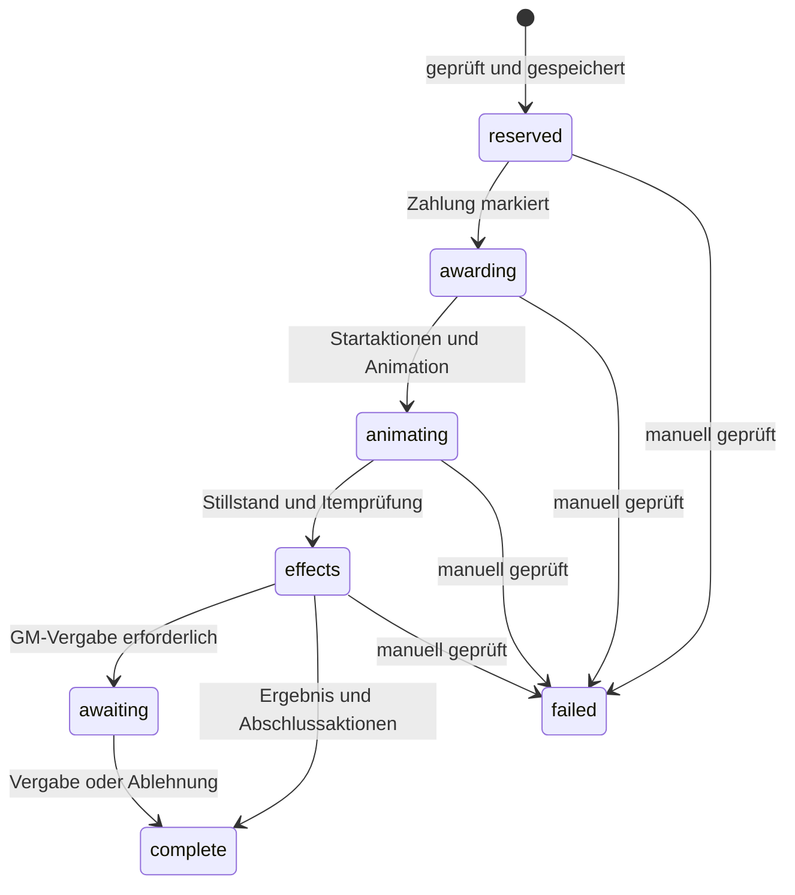

# Technische Spezifikation

## Zielplattform und Architektur

Foundry VTT Generation 14; native JavaScript-ES-Module. Kein Build-Framework, keine Remote-CDNs, keine Socketbibliothek. `module.json` begrenzt die Generation auf 14. `verified` fehlt absichtlich bis zur tatsächlichen Live-Abnahme. Programmversion `0.5.0-alpha.5` bezeichnet die Implementierung, nicht den Nachweis vollständiger Konzeptparität.

| Schicht | Dateien | Verantwortung |
|---|---|---|
| Reines Modell | `scripts/core/model.js` | Schema, Validierung, Gewichtung, Bestände, Limits, öffentliche Projektion, Animationwinkel |
| Zustandsmaschine | `scripts/core/engine.js` | Serialisierte Reservierung, Zahlungen, Vergabe, Lifecycle, Wiederaufnahme, GM-Entscheidungen |
| Foundry-Adapter | `scripts/foundry/` | Journale, Actor-Updates, Item-/Effect-Erstellung, Dokumenttransport, Szene und Eingaben |
| Oberflächen | `scripts/ui/` | ApplicationV2-Editor, animierte Canvas-Spieleransicht, FX, Formulare |
| Einstieg | `scripts/main.js` | Hooks, Einstellungen, Tasten, Abhängigkeiten und öffentliche API |
| Werkzeuge | `tools/` | Syntax-/Ressourcenprüfung und reproduzierbares Installationsarchiv |
| Tests | `tests/` | Node-Test-Runner; Ports und Foundry-Verträge isoliert ersetzbar |

## Persistenz

Ein GM-registriertes `JournalEntry` pro Rad. Standardownership ist NONE für Spieler; GMs bearbeiten über den Editor. Die Welt-Einstellung `arcane-wheels.registry` enthält die zugelassenen Journal-IDs. Ein beliebiges Journal mit nachgeahmten Flags wird nicht geladen.

Das Journal enthält `flags.arcane-wheels.kind`, `wheelId` und einen JSON-String `record`. Der String ersetzt Konfiguration und Zustand als ein skalares Feld; Foundrys rekursives Object-Merging kann dadurch entfernte Unterobjekte nicht wiederbeleben. `record.schema` ist 3. Version 2 erhält zusätzlich Darstellungsvorgaben und einzelne Beschriftungs-/Sichtbarkeitsfelder; IDs und der gesamte Zustand bleiben unverändert. Version 1 wird verlustfrei bezüglich Laufzeit-/Vergabedaten migriert: alte relative Gewichte werden zu Prozentchancen mit zwei Nachkommastellen und exakt 100 % Gesamtsumme; fehlende Motive erhalten den Halloween-Mix. Unbekannte Versionen werden vor Änderungen abgelehnt.

```text
record
  schema
  config
    id, name, enabled, design, description, duration, showOdds, showStock, appearance
    rules { userIds, range, cost, maxSpins, cooldown,
            identity, limitScope, limitResetSeconds }
    stockResetSeconds
    segments[] { id, label, chance, theme, image, stock, color, enabled,
                 itemUuid, delivery, actions[], showChance, showStock,
                 textDirection, fontSize }
    placements[] { id, sceneId, documentId, name, kind, pool, enabled }
    actions[] { id, type, phase, target, userIds, radius,
                duration, value, color, volume }
  state
    revision
    pools { poolId: { resetAt, remaining: { segmentId: number|null } } }
    limits { identityKey: { count, lastAt, resetAt } }
    spins[] { id, userId, actorUuid, tokenUuid, placementId,
              at, worldTime, status, cost, segment, view, resultView?, actions,
              actionStates, charged, delivery, animationAt,
              resultSent, error, resolution? }
```

Platzierungen verweisen auf echte `TileDocument`- oder `TokenDocument`-IDs. Öffentliche Platzierungsflags enthalten nur Rad-/Platzierungs-ID, Art und Namen. Autoritative Regeln liegen in der registrierten Raddefinition. NPC-Tokens werden beim Entfernen einer Platzierung nicht gelöscht; modulerstellte Rad-/Zonen-Tiles dagegen schon.

## Anfrage- und Autoritätsmodell

Die aktive GM-Instanz wird mit `game.users.activeGM` bestimmt. Spieleranfragen verwenden **Foundrys ChatMessage-Dokumente** statt unbeglaubigter Custom-Socket-Payloads. Das `createChatMessage`-Hook erhält den von Foundry bereitgestellten `userId` des Erstellers. Ein `userId` innerhalb eines Payloads wird nie als Identität übernommen.

1. Spieler erstellt eine an GMs geflüsterte Anfrage mit `preview` oder `spin`, Rad-/Platzierungs-ID und Token-UUID.
2. Zuständiger GM lädt die registrierte Definition und prüft Zugriff, aktiven Spieler, Tokenbesitz, Szene, sichtbare Platzierung, Kennzeichnung und Reichweite.
3. GM-Antworten/Animation/FX sind GM-erstellte Dokumente. Clients verwerfen Nicht-GM-Ersteller unabhängig von nachgeahmten Flags oder Autoranzeige.
4. Aufbewahrte Antwortdokumente benötigen einen GM als `author` und in dem serververwalteten Feld `_stats.lastModifiedBy`. Nachrichten-IDs bilden die Spin-IDs; Antworten/FX erhalten deterministische Ereignis-IDs.

Routine-Chatdokumente bleiben als authentifizierter, persistenter Flüstertransport erhalten, werden jedoch über das offizielle `renderChatMessageHTML`-Hook vor dem Einfügen in den Chat unsichtbar gemacht. Nur ein ausdrücklich konfigurierter Chat-Effekt wird angezeigt. Es werden keine Chatdokumente gelöscht und keine fremden Nachrichten versteckt. Das Datenprotokoll im GM-Bereich Betrieb bleibt erhalten. Fehlende Chat-Erstellungsberechtigung blockiert den Vorgang sichtbar. Eine leere FX-Zielliste erzeugt **keine** Nachricht, weil eine leere Whisperliste sonst öffentlich wäre.

Ein globales Promise-Queue-Objekt serialisiert Modulmutationen und auch Kostenänderungen an demselben Actor. Anfragen, die mehr als 45 reale Sekunden in der Queue gewartet haben, werden vor Reservierung verworfen. Clientantworten warten höchstens 90 Sekunden. Für die aktuelle Alpha laufen Radanimationen innerhalb der Queue; parallele Spins werden nacheinander abgewickelt.

## Drehablauf und Wiederaufnahme



Vor der ersten Änderung an Actor oder FX wird Auswahl, Bestandsverbrauch, Zähler und eingefrorener Gewinnkontext gespeichert. Die Item-UUID und benötigte Macro-/Effect-Dokumente werden vorher geprüft. Die Auslosung verwendet `crypto.getRandomValues`, nicht das Animationsergebnis. Segmentgewichte, Bestände und FX kommen ausschließlich aus der GM-Konfiguration.

Zahlungsabzug und Zahlungsmarkierung erfolgen in **einem Actor.update**. Bei Wiederaufnahme verhindert diese Markierung einen zweiten Abzug. Ein kopiertes Item trägt `flags.arcane-wheels.award = spinId`; ein ActiveEffect `flags.arcane-wheels.action = spinId:actionKey`. Vor erneutem Erstellen wird nach diesen Markierungen gesucht. Der Verlust einer Bestätigungsantwort führt damit nicht automatisch zu einer doppelten Änderung.

Jedes GM-Makro wird vor Ausführung als `running` gespeichert. Endet die Ausführung oder Bestätigung unklar, blockiert die Wiederaufnahme dieses Makro, bis der GM es geprüft und als erledigt markiert hat. Beliebiger Makrocode lässt sich nicht allgemeingültig rückgängig machen oder sicher wiederholen.

Nicht abgeschlossene Transaktionen blockieren weitere Drehungen dieses Rads. Reine GM-Vergabewünsche (`awaiting`) blockieren nicht. Als letzter Ausweg kann der GM eine unterbrochene Transaktion mit Prüfnotiz auf `failed` setzen. Kosten, Inventar und Vorrat werden dabei nicht automatisch zurückgerollt.

Das Verfahren ist eine **Wiederaufnahmestrategie**, keine verteilte Datenbanktransaktion. Manuelle Änderungen an Markierungen, Löschen eines bereits vergebenen Items, mehrere steuernde Clients mit derselben GM-Identität oder konkurrierende Fremdmodule liegen außerhalb einer Exactly-once-Garantie.

## Regeln und mathematische Bedeutung

`stock = null` bedeutet unbegrenzt, `0` bedeutet erschöpft. Nur aktivierte Segmente mit positiver Prozentchance und verfügbarem Bestand werden gezogen. Für ein verfügbares Segment ist `P(s) = chance(s) / Summe(verfügbarer Chancen)`. Erschöpfte Segmente werden nicht neu gezogen und es existiert kein stiller Ersatzgewinn.

Vorratspool: `shared` für alle gemeinsamen Platzierungen eines Rads, sonst Platzierungs-ID. Die ID `shared` ist für einzelne Platzierungen reserviert und wird als Eingabe abgelehnt. Limits haben ihre eigene Zuordnung: pro Actor/Account, jeweils pro Rad/Platzierung. Ein anderer Vorratspool erzeugt deshalb nicht automatisch ein anderes Drehlimit.

Zeitgesteuerte Resets sind relativ zur ersten Nutzung/letztem Reset eines Pools oder Limitdatensatzes. Es gibt keinen angenommenen Mitternachtswechsel. Ein Rücksprung der Weltzeit setzt nichts zusätzlich zurück. Kosten von Null lesen kein Währungsfeld; dadurch funktionieren freie Räder auch in Systemen ohne `system.currency`.

Die Interaktionsentfernung ist die kürzeste horizontale Entfernung zwischen den Token-/Tile-Flächen. Gedrehte Tiles werden als gedrehte Polygone behandelt; überlappende Flächen haben Abstand 0. Es wird mit `grid.distance/grid.size` in Szeneneinheiten umgerechnet. Höhen werden für die normale Interaktion nicht addiert. Bestehende Legacy-Zonen behalten ihren Kreiseintritt. FX-Radien verwenden weiterhin ihre eigene Mittelpunkt-/Höhendistanz. Keine Wand- oder Sichtlinienprüfung wird behauptet.

## Offizielle V14-Schnittstellen

Am 23.10.2026 geprüft. Die Referenzseite bezeichnete ihre API als V14.368 Stable; diese Prüfung ersetzt keine Ausführung im Foundry-Client.

| Schnittstelle | Verwendung | Offizielle Referenz |
|---|---|---|
| ApplicationV2 | `_renderHTML`, `_replaceHTML`, `_onRender`, Render-/Close-Lifecycle | https://foundryvtt.com/api/v14/classes/foundry.applications.api.ApplicationV2.html |
| DialogV2 | `input`, `confirm` für Konfiguration und bewusste GM-Entscheidungen | https://foundryvtt.com/api/v14/classes/foundry.applications.api.DialogV2.html |
| createDocument-Hook | Serverseitiger Ersteller-`userId` in `createChatMessage` | https://foundryvtt.com/api/v14/functions/hookEvents.createDocument.html |
| ChatMessage / BaseChatMessage | `author`, `whisper`, `timestamp`, `flags`, `create` | https://foundryvtt.com/api/v14/classes/foundry.documents.BaseChatMessage.html |
| DocumentStatsField / DocumentStats | Serververwaltetes `lastModifiedBy` für aufbewahrte GM-Ereignisse | https://foundryvtt.com/api/v14/interfaces/foundry.data.types.DocumentStats.html |
| JournalEntry | Registrierte Raddefinition, `getFlag`/`setFlag` | https://foundryvtt.com/api/v14/classes/foundry.documents.JournalEntry.html |
| Actor | `update`, `createEmbeddedDocuments`, `items`, `effects` | https://foundryvtt.com/api/v14/classes/foundry.documents.Actor.html |
| TokenDocument | Szene, Actor/Synthetic Actor, Position und Höhe | https://foundryvtt.com/api/v14/classes/foundry.documents.TokenDocument.html |
| TileDocument | Native Szenenplatzierung mit Textur und Flags | https://foundryvtt.com/api/v14/classes/foundry.documents.TileDocument.html |
| ClientKeybindings | `register`, Modifier `Shift`/`Control` | https://foundryvtt.com/api/v14/classes/foundry.helpers.interaction.ClientKeybindings.html |
| AudioHelper | `play({src,volume,loop,autoplay:true}, false)` pro adressiertem Client | https://foundryvtt.com/api/v14/classes/foundry.audio.AudioHelper.html |
| Macro | `canExecute`, `execute(scope)` | https://foundryvtt.com/api/v14/classes/foundry.documents.Macro.html |
| Users | `activeGM` als zuständiger GM | https://foundryvtt.com/api/v14/classes/foundry.documents.collections.Users.html |

Weitere offizielle Grundlage: https://foundryvtt.com/article/module-development/

Es werden weder V1-Fensterklassen noch globales `mergeObject`, `eval`, dynamischer Funktionscode oder Monkeypatches von Foundry-Prototypen benutzt.


## Zielumgebung und neue Schnittstellen in Alpha 2

Ziel: Foundry VTT 14.367, D&D5e 6.0.6. Kein `verified`-Eintrag ohne Ausführung auf dieser Installation.

- `getSceneControlButtons(controls)` erhält in V14 einen Record. Der eigene Rad-Eintrag verwendet `SceneControl` mit `tools`, `onChange` und GM-Sichtbarkeit der Verwaltung.
- Die Spieleranzeige nutzt `ApplicationV2` mit `window.frame: false` und `window.positioned: false`, transparente CSS-Positionierung über den ganzen Viewport und eigene Schließen-/Zoom-Steuerung.
- Eigene Segmentbilder werden über `foundry.applications.apps.FilePicker` ausgewählt und über dessen integrierten Upload gespeichert; keine nur lokal funktionierenden Blob-URLs.
- Offizielle D&D5e-6.0.6-Quelle: https://raw.githubusercontent.com/foundryvtt/dnd5e/release-6.0.6/module/data/shared/currency.mjs. `CurrencyTemplate` definiert `system.currency` als numerisches Mapping; die gemeinsame Actor-Vorlage bindet es ein.
- Referenzen: https://foundryvtt.com/api/v14/functions/hookEvents.getSceneControlButtons.html, https://foundryvtt.com/api/v14/interfaces/foundry.SceneControl.html, https://foundryvtt.com/api/v14/interfaces/foundry.applications.types.ApplicationWindowConfiguration.html, https://foundryvtt.com/api/v14/classes/foundry.applications.apps.FilePicker.html.


## Darstellung und Beschriftung in Alpha 3

`appearance` enthält `textDirection` (`radial`, `horizontal`, `vertical`), `fontSize` (8–96), `dim` (0–90), `glow` und `decorations`. Segmentfelder überschreiben Richtung mit `inherit` und Schriftgröße mit `null` als Vererbung. Größen sind Wunschgrößen im 1024-Pixel-Canvas und werden automatisch nach unten angepasst. Vertikal dreht den gesamten Text um 90°, einschließlich seiner Metadaten; es ist kein Buchstabenstapel.

Der Layoutalgorithmus berechnet für jede Schrift-/Zeilenzahl ein einbeschriebenes Rechteck. Sektorhalbebenen, Außenradius und Abstand zur Nabe begrenzen dessen Größe einschließlich Randreserve. Namen werden an Wörtern beziehungsweise bei Bedarf an Unicode-Codepoints umgebrochen. Die tatsächliche Canvas-Textbreite wird gemessen. Zusätzlich begrenzt ein Canvas-Clip die Zeichnung am Sektor. Bei extrem schmalen Segmenten ohne nutzbaren Textplatz wird keine überlappende Beschriftung erzwungen; vollständige Namen stehen in der Gewinnliste.

Die Projektion gibt `chance` nur bei `segment.showChance` und `remaining` nur bei `segment.showStock` frei. `remaining=null` bedeutet unbegrenzt; `0` bleibt ausdrücklich 0. Globale Schalter im Editor setzen die jeweiligen Segmentfelder gemeinsam; sie verhindern keine nachträglichen individuellen Ausnahmen.

`spin.view` hält die Auslosungschancen vor dem Verbrauch fest. `spin.resultView` speichert nach der Reservierung verbleibenden Bestand, Verfügbarkeit und neu normierte Chancen für die nächste Drehung. Das Ergebnis aktualisiert Canvas und Gewinnliste aus dieser Projektion. Alte offene Spins ohne `resultView` verwenden unverändert ihre vorherige Projektion.

Die Kulisse ist ausschließlich HTML/CSS innerhalb der lokalen ApplicationV2-Ansicht. Schließen entfernt Hintergrund, Lichtschein, Geister und Dekoration; es gibt kein `Scene.update`, keine Änderung an `darkness` und keine erzeugten AmbientLights. Die Grafik `pumpkin-cluster.svg` ist lokal und benötigt keine Fremdressourcen.

Die eigene SceneControl kehrt nach erfolgreichem oder fehlgeschlagenem Öffnungsversuch mit `ui.controls.activate({control:"tokens",tool:"select"})` zur Token-Auswahl zurück. Das macht den nächsten Klick wieder zu einer Aktivierung; es werden keine internen Foundry-Handler ersetzt. Referenz: https://foundryvtt.com/api/v14/classes/foundry.applications.ui.SceneControls.html#activate.

Das Chat-Hook liefert in V14 ein `HTMLElement`, kein jQuery-Objekt: https://foundryvtt.com/api/v14/functions/hookEvents.renderChatMessageHTML.html. Es setzt `hidden`, `aria-hidden` und eine ausschließlich für Transportkarten verwendete Klasse. Die Flüsterrechte und serverseitige Erstelleridentität bleiben bestehen. Alle Clients müssen nach dem Update neu laden.
